# SECURE HEALTHCARE MANAGEMENT SYSTEM

**A Secure Backend Application Using Spring Boot, Spring Security, PostgreSQL, Redis and Docker**

---

## 1. Abstract

The Secure Healthcare Management System is a backend application developed using Java and Spring Boot. The primary purpose of this project is to provide a secure and efficient platform for managing patient information and healthcare-related user operations.

Healthcare applications handle important personal information. Therefore, security, data protection, authentication, authorization, and reliable database management are essential.

This project implements JWT-based authentication, Role-Based Access Control (RBAC), Two-Factor Authentication (2FA), AES/GCM encryption, audit logging, and Redis caching.

PostgreSQL is used as the primary relational database, while Redis is used to improve data retrieval performance through caching. Docker and Docker Compose provide a containerized environment for application deployment.

The project also integrates Swagger/OpenAPI for API documentation and Spring Boot Actuator for application health monitoring.

---

## 2. Introduction

Healthcare management systems help organizations maintain and manage patient-related information efficiently.

Traditional information management approaches may involve challenges such as:
- Difficulty in managing patient records.
- Unauthorized access to sensitive information.
- Lack of centralized data management.
- Repeated database requests.
- Difficulty monitoring application performance.
- Insufficient tracking of important user activities.

The Secure Healthcare Management System addresses these challenges by implementing a structured backend application with modern Java technologies.

The system provides RESTful APIs that allow authorized users to perform patient management operations while applying security rules.

---

## 3. Problem Statement

Managing healthcare information requires a reliable and secure application.

An application without proper authentication and authorization may expose sensitive information to unauthorized users. Repeated database operations can also affect application performance.

The proposed system addresses these concerns through:

1. Secure user authentication.
2. Role-based access permissions.
3. Two-factor authentication.
4. Encryption of sensitive 2FA information.
5. Centralized patient information management.
6. Redis-based caching.
7. Audit logging.
8. Application health monitoring.
9. Containerized deployment.

---

## 4. Project Objectives

The main objectives of this project are:

- To develop a secure healthcare backend application using Spring Boot.
- To implement JWT-based authentication.
- To provide role-based access control.
- To implement Two-Factor Authentication.
- To protect sensitive information using encryption.
- To maintain patient information using REST APIs.
- To integrate PostgreSQL for persistent data storage.
- To improve application performance using Redis caching.
- To maintain audit logs for important activities.
- To monitor application health using Spring Boot Actuator.
- To provide API documentation using Swagger.
- To deploy the application using Docker and Docker Compose.
- To test application functionality using automated tests.

---

## 5. Scope of the Project

The scope of this project includes backend development and secure API management.

The system focuses on the following areas:

### User Management
- User registration.
- User login.
- Authentication using JWT.
- Role-based access permissions.

### Patient Management
- Creating patient records.
- Retrieving patient information.
- Updating patient details.
- Deleting patient records.

### Application Security
- JWT token validation.
- Two-factor authentication.
- Sensitive data encryption.
- Security configuration.
- Audit logging.

### Performance and Monitoring
- Redis caching.
- Cache eviction.
- Application health monitoring.
- Database connectivity monitoring.
- Prometheus metrics exposure.

### Deployment
- Docker image creation.
- Docker container execution.
- Redis container management.
- Docker Compose configuration.

---

## 6. Technologies Used

| Technology | Purpose |
|---|---|
| Java 21 | Backend programming language |
| Spring Boot 4.0.9 | Application framework |
| Spring Security | Application security |
| Spring Data JPA | Database operations |
| Hibernate | ORM implementation |
| PostgreSQL 17 | Relational database |
| Redis 7 | Caching |
| JWT | Token-based authentication |
| AES/GCM | Sensitive data encryption |
| Maven | Build and dependency management |
| Swagger / OpenAPI | API documentation |
| Spring Boot Actuator | Health monitoring |
| Micrometer | Application metrics |
| Prometheus | Metrics endpoint integration |
| JUnit | Application testing |
| Docker | Containerization |
| Docker Compose | Multi-container management |
| Visual Studio Code | Development environment |

---

## 7. System Architecture

The application follows a layered backend architecture.

### Architecture Overview

```text
             CLIENT / API USER
                    |
                    |
               REST API
                    |
                    |
          SPRING SECURITY LAYER
                    |
           JWT AUTHENTICATION
                    |
          ROLE-BASED AUTHORIZATION
                    |
                    |
          CONTROLLER LAYER
                    |
                    |
           SERVICE LAYER
                    |
          -------------------
          |                 |
     JPA REPOSITORY    REDIS CACHE
          |                 |
          |                 |
      POSTGRESQL           REDIS
          |
          |
       DATABASE
```

### Architecture Description

**Client Layer:** Sends HTTP requests to the backend application.

**Security Layer:** Validates authentication credentials and JWT tokens. It also checks user permissions.

**Controller Layer:** Receives HTTP requests and returns appropriate responses.

**Service Layer:** Contains the application business logic.

**Repository Layer:** Communicates with the PostgreSQL database using Spring Data JPA.

**Database Layer:** Stores application information persistently.

**Caching Layer:** Redis stores frequently accessed patient information to reduce repeated database queries.

**Monitoring Layer:** Spring Boot Actuator provides application health and metrics information.

---

## 8. System Modules

### 8.1 Authentication Module

The authentication module manages user registration and login.

Main responsibilities:
- Register new users.
- Authenticate registered users.
- Validate login credentials.
- Generate JWT access tokens.
- Validate authentication requests.
- Support additional 2FA verification.

### 8.2 Authorization Module

The authorization module controls access to application resources.

The project implements Role-Based Access Control.

The configured roles include:

- ADMIN
- DOCTOR
- PATIENT

Access to protected endpoints is controlled based on the assigned role.

### 8.3 Patient Management Module

The patient module provides CRUD operations.

CRUD represents:

- Create
- Read
- Update
- Delete

The module supports:
- Creating patient records.
- Viewing all patient records.
- Viewing an individual patient.
- Updating existing information.
- Deleting patient information.

### 8.4 Two-Factor Authentication Module

Two-Factor Authentication adds another verification step to the login process.

The project includes:
- 2FA setup endpoint.
- 2FA confirmation endpoint.
- Authenticator application integration.
- Verification of time-based authentication codes.
- Encrypted storage of the 2FA secret.

### 8.5 Encryption Module

The encryption module protects sensitive authentication-related information.

The project uses AES/GCM/NoPadding.

AES/GCM provides encryption and authentication of encrypted data.

The encryption key is supplied through an environment variable instead of being hardcoded in the application source code.

### 8.6 Audit Logging Module

Audit logging helps track important application activities.

Examples of recorded activities include:
- User login.
- Patient creation.
- Patient viewing.
- Patient deletion.

Audit records help with application activity tracking and debugging.

### 8.7 Redis Caching Module

Redis is used as an in-memory caching system.

The project uses caching to reduce repeated database access for frequently requested patient information.

Important caching operations:
- Cache patient information.
- Retrieve cached information.
- Evict outdated cache entries after updates.
- Evict cache entries after deletion.

### 8.8 Monitoring Module

Spring Boot Actuator provides monitoring endpoints.

The project exposes health and metrics information through configured actuator endpoints.

Important endpoints:
- `/actuator/health`
- `/actuator/prometheus`
- `/actuator/metrics`

The health endpoint provides information about configured application components such as PostgreSQL and Redis.

---

## 9. Database Design

### Database Information

| Property | Value |
|---|---|
| Database | PostgreSQL |
| Version | 17 |
| Database Name | healthcare_db |
| ORM | Hibernate |
| Data Access | Spring Data JPA |

PostgreSQL is used for persistent application data storage.

Spring Data JPA provides repository-based database operations, while Hibernate handles object-relational mapping.

### Patient Entity

The Patient entity contains patient-related information.

The implemented fields include:

| Field | Description |
|---|---|
| id | Unique patient identifier |
| name | Patient name |
| email | Patient email address |
| phone | Patient contact number |

### User Entity

The AppUser entity is used for application user and authentication-related information.

It includes user-related information such as username, password, role, and 2FA status.

The application also maintains encrypted 2FA information.

---

## 10. REST API Documentation

The application provides RESTful APIs for authentication, patient management, two-factor authentication, and administration.

### 10.1 Authentication APIs

| HTTP Method | Endpoint | Description |
|---|---|---|
| POST | `/api/auth/register` | Register a new user |
| POST | `/api/auth/login` | Authenticate a user |

### 10.2 Patient APIs

| HTTP Method | Endpoint | Description |
|---|---|---|
| POST | `/api/patients` | Create a patient |
| GET | `/api/patients` | Retrieve all patients |
| GET | `/api/patients/{id}` | Retrieve patient by ID |
| PUT | `/api/patients/{id}` | Update patient information |
| DELETE | `/api/patients/{id}` | Delete a patient |

### 10.3 Two-Factor Authentication APIs

| HTTP Method | Endpoint | Description |
|---|---|---|
| POST | `/api/auth/2fa/setup` | Set up two-factor authentication |
| POST | `/api/auth/2fa/confirm` | Confirm 2FA verification |

### 10.4 Administration API

| HTTP Method | Endpoint | Description |
|---|---|---|
| GET | `/api/admin/test` | Test the protected admin endpoint |

---

## 11. API Request and Response Examples

The following examples demonstrate the expected structure of patient API requests. They use fictional sample information.

### Create Patient

**Endpoint:** `POST /api/patients`

Sample request:

```json
{
  "name": "Sample Patient",
  "email": "patient@example.com",
  "phone": "9876543210"
}
```

### Retrieve All Patients

**Endpoint:** `GET /api/patients`

This endpoint retrieves the available patient records based on the authenticated user's permissions.

### Retrieve Patient by ID

**Endpoint:** `GET /api/patients/1`

This endpoint retrieves a specific patient using the patient ID.

### Update Patient

**Endpoint:** `PUT /api/patients/1`

Sample request:

```json
{
  "name": "Updated Patient",
  "email": "updated@example.com",
  "phone": "9876543210"
}
```

### Delete Patient

**Endpoint:** `DELETE /api/patients/1`

This endpoint deletes the selected patient record.

---

## 12. Security Implementation

Security is one of the major components of this project.

### JWT Authentication

JSON Web Tokens are used to authenticate API requests.

After successful authentication, the application generates a JWT token.

The token is used to access protected API endpoints.

### Role-Based Access Control

The application uses roles to control access to different resources.

The configured permissions include:

- Admin access to admin endpoints.
- Doctor and Admin access to doctor endpoints.
- Patient, Doctor, and Admin access to patient endpoints.

### Password Authentication

The authentication module validates user credentials through the configured Spring Security authentication provider.

### Two-Factor Authentication

The application provides an additional verification mechanism through an authenticator application.

### AES/GCM Encryption

The encryption module uses AES/GCM/NoPadding to protect sensitive 2FA data.

### Stateless Security

The Spring Security configuration uses stateless session management with JWT-based authentication.

### Environment Variables

Sensitive configuration values are supplied through environment variables.

Examples of configuration variable names:

- `DB_PASSWORD`
- `HEALTHCARE_JWT_SECRET`
- `HEALTHCARE_ENCRYPTION_KEY`
- `HEALTHCARE_ADMIN_USERNAME`
- `HEALTHCARE_ADMIN_PASSWORD`

Actual secret values must not be stored in GitHub, README files, screenshots, or source control.

---

## 13. Redis Caching Implementation

Redis is integrated into the application to improve data retrieval performance.

### Benefits

- Reduces repeated database queries.
- Improves retrieval efficiency for cached records.
- Supports cache eviction when information changes.
- Reduces unnecessary database operations.

### Cache Operations

**Cache Read:** Retrieves previously cached patient information when available.

**Cache Write:** Stores patient information in Redis.

**Cache Eviction:** Removes outdated entries when patient data is modified or deleted.

Redis connectivity is verified through the application health endpoint.

---

## 14. Monitoring and Metrics

Spring Boot Actuator is integrated for application monitoring.

### Health Monitoring

Endpoint:

```text
http://localhost:8080/actuator/health
```

This endpoint reports the overall application health and configured component health.

### Prometheus Metrics

Endpoint:

```text
http://localhost:8080/actuator/prometheus
```

This endpoint exposes metrics in Prometheus format.

### Metrics Endpoint

Endpoint:

```text
http://localhost:8080/actuator/metrics
```

This endpoint provides available application metrics.

Monitoring helps identify application availability and component connectivity.

---

## 15. Docker Deployment

Docker is used to package the application into a container.

Docker Compose manages the healthcare application and Redis service.

### Docker Services

| Service | Container | Port |
|---|---|---|
| Healthcare Application | healthcare-app | 8080 |
| Redis | healthcare-redis-compose | 6379 |

PostgreSQL runs on the host machine and is accessed by the application container through the configured host connection.

### Dockerfile

The Dockerfile uses the Eclipse Temurin Java 21 runtime image.

It copies the generated JAR file into the container and starts the Spring Boot application.

### Docker Compose

Docker Compose defines:
- Healthcare application service.
- Redis service.
- Application port mapping.
- Redis port mapping.
- Environment-based configuration.
- Redis persistent volume.
- Container restart policies.

### Build Docker Image

```powershell
.\mvnw.cmd clean package
```

```powershell
docker build -t healthcare-system:latest .
```

### Start Containers

```powershell
docker compose up -d
```

### Check Running Containers

```powershell
docker ps
```

### View Application Logs

```powershell
docker compose logs --tail=50 healthcare-app
```

### Stop Containers

```powershell
docker compose down
```

---

## 16. Application Configuration

The application configuration is maintained in:

`src/main/resources/application.properties`

Important configuration areas include:

- PostgreSQL connection.
- JPA and Hibernate settings.
- Redis connection.
- JWT configuration.
- Encryption configuration.
- Actuator settings.
- Application port.

Sensitive configuration values are supplied using environment variables.

The actual secret values should remain private and must not be included in project documentation.

---

## 17. Testing

Testing is performed to verify application functionality and reliability.

### Unit and Integration Tests

The project includes automated tests using JUnit and the configured Spring testing framework.

Run tests using:

```powershell
.\mvnw.cmd test
```

### API Testing

Swagger UI is used to explore and test REST API endpoints.

### Patient CRUD Testing

The following operations are tested:

1. Create a patient.
2. Retrieve all patients.
3. Retrieve a patient by ID.
4. Update patient information.
5. Delete a patient.

### Redis Testing

Redis cache entries can be checked through the Redis command-line interface.

Example:

```powershell
docker exec healthcare-redis-compose redis-cli PING
```

Expected response:

```text
PONG
```

### Health Testing

The Actuator health endpoint is used to verify application, database, and Redis health.

---

## 18. How to Run the Project

### Prerequisites

Install the following software:

1. Java Development Kit 21.
2. Visual Studio Code.
3. Docker Desktop.
4. PostgreSQL.
5. Maven Wrapper included in the project.

### Step 1: Open the Project

Open the project root directory in Visual Studio Code.

### Step 2: Configure Environment Variables

Configure the required database password, JWT secret, encryption key, and admin credentials in the environment.

Do not publish the actual secret values.

### Step 3: Build the Project

```powershell
.\mvnw.cmd clean package
```

### Step 4: Build the Docker Image

```powershell
docker build -t healthcare-system:latest .
```

### Step 5: Start the Application

```powershell
docker compose up -d
```

### Step 6: Verify Containers

```powershell
docker ps
```

### Step 7: Open Swagger UI

```text
http://localhost:8080/swagger-ui/index.html
```

### Step 8: Check Application Health

```text
http://localhost:8080/actuator/health
```

---

---

## 19. Application Screenshots

The following screenshots demonstrate the working application and its implemented features.

### Application Screenshots

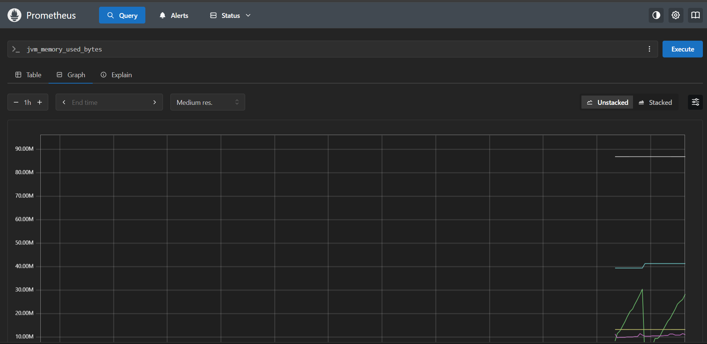
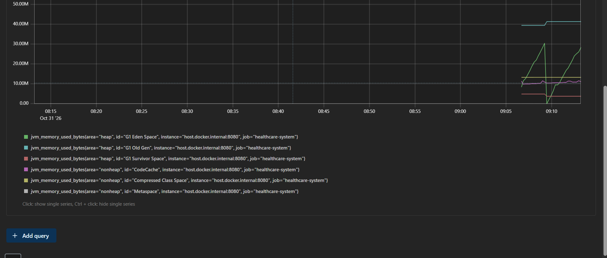
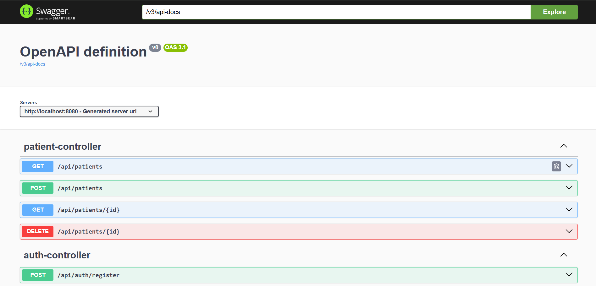
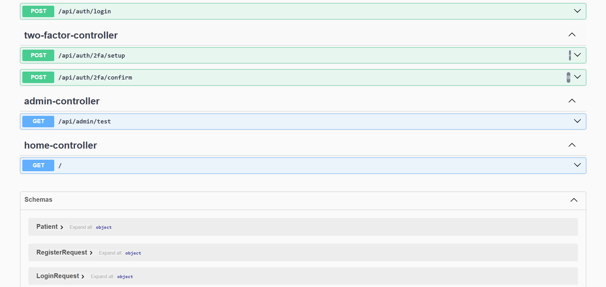
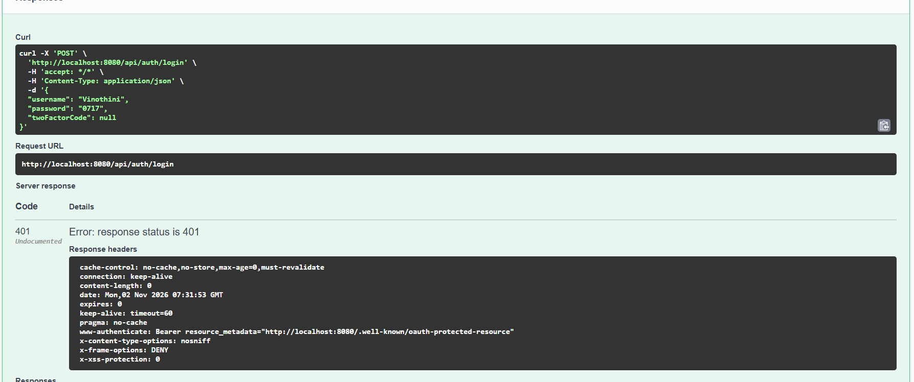
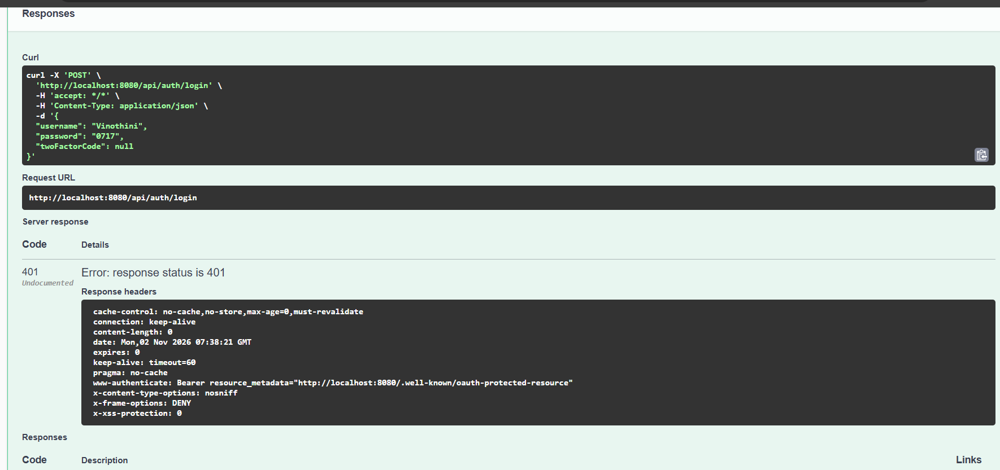
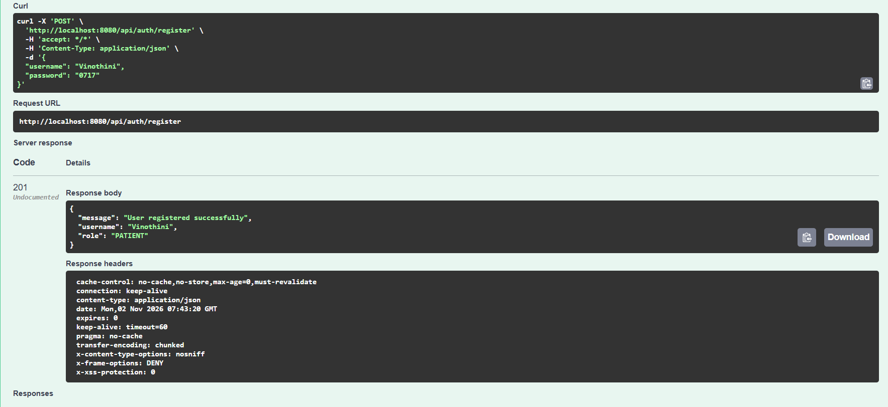
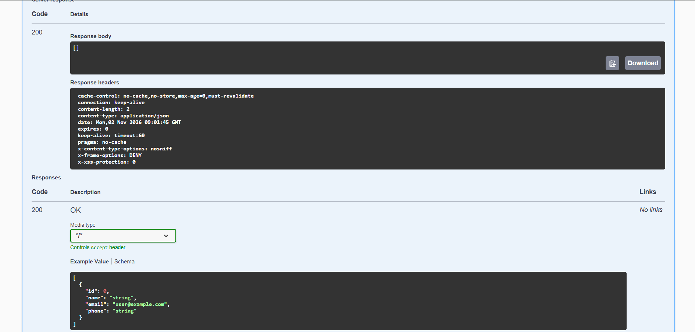
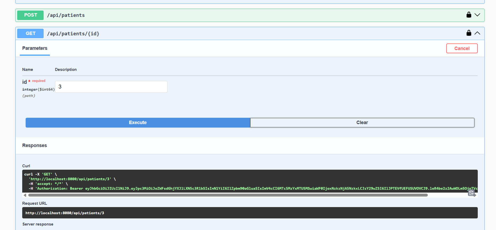
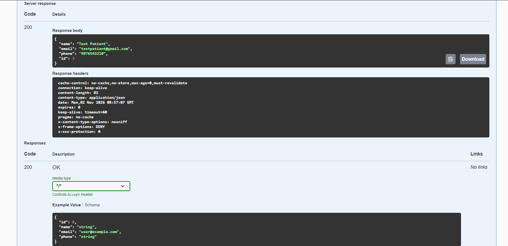
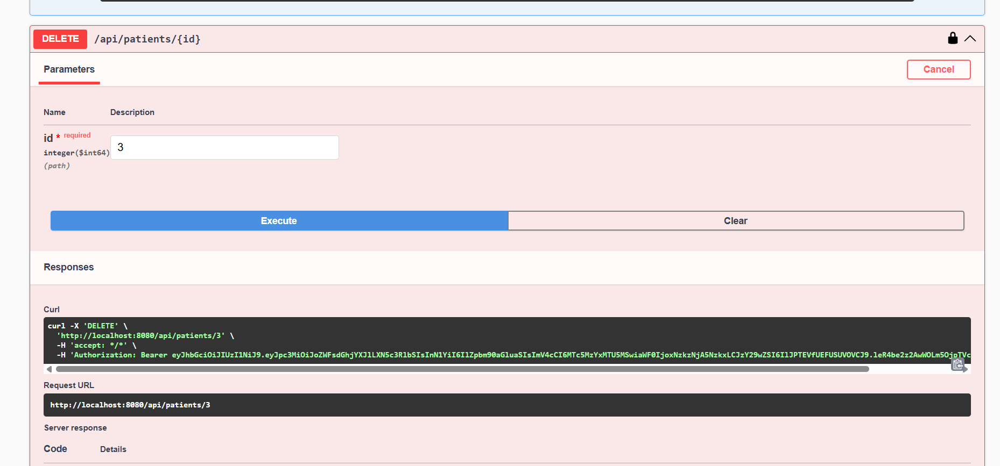
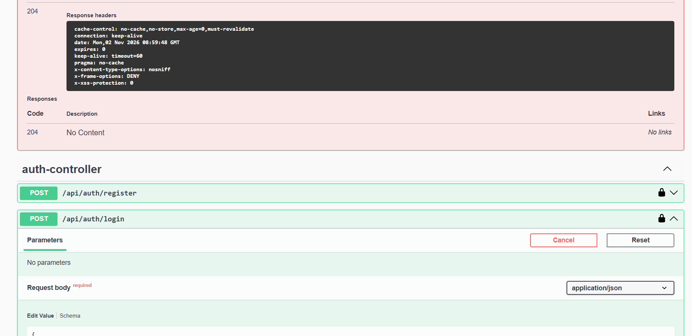
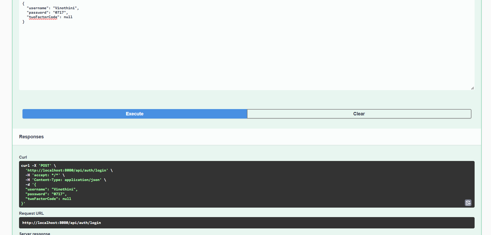
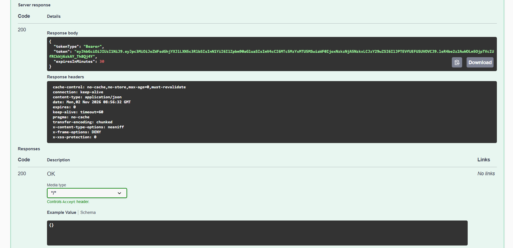
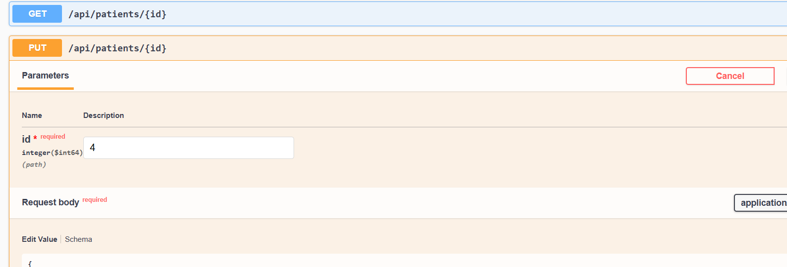
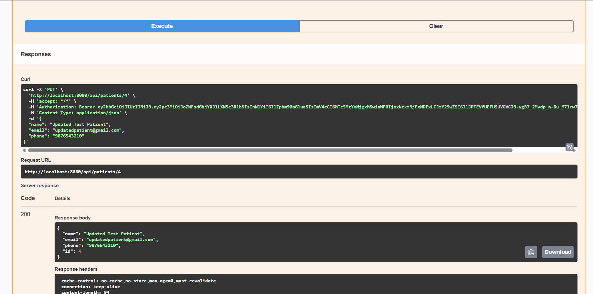
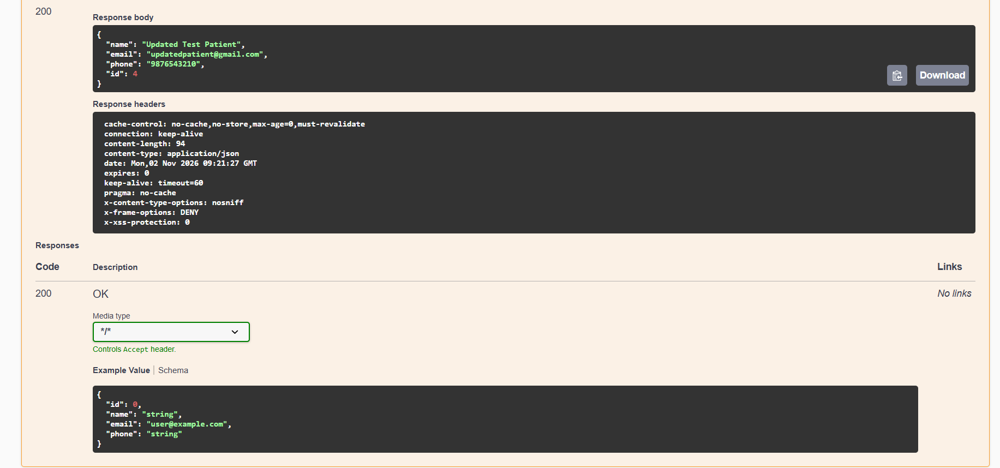
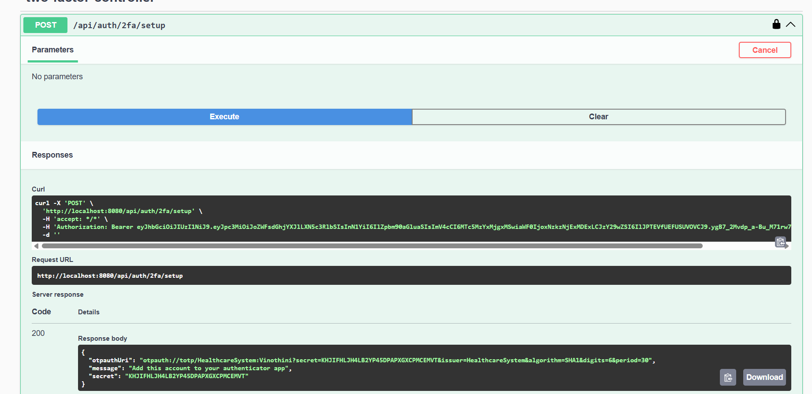
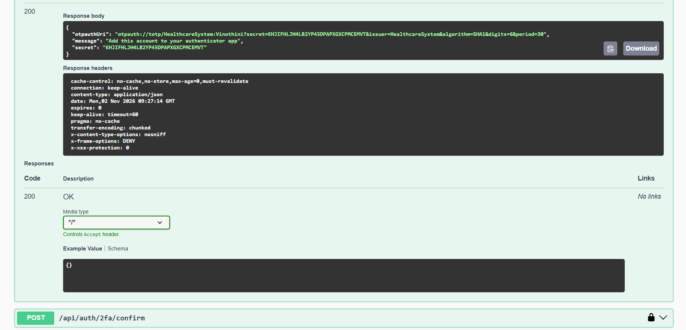
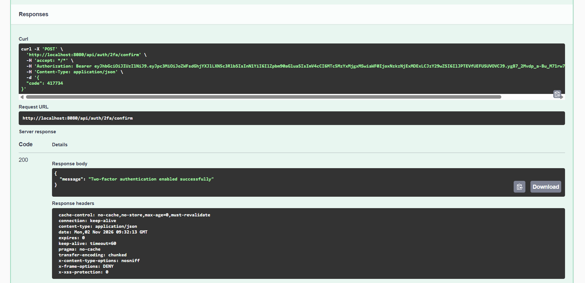

## 20. Advantages of the System

- Centralized patient information management.
- Secure authentication and authorization.
- Additional login verification through 2FA.
- Encryption of sensitive 2FA information.
- Role-based API access.
- Audit logging for important activities.
- Improved data retrieval through Redis caching.
- Persistent database storage using PostgreSQL.
- API documentation through Swagger.
- Application health monitoring.
- Containerized application deployment.
- Environment-based secret configuration.

---

## 21. Limitations

The current implementation is focused on backend healthcare information management.

The project does not represent a complete hospital information system.

The current implementation can be extended with additional healthcare workflows, user interfaces, and integrations.

It should be treated as an educational project and not used to process real patient information without further security, privacy, and compliance reviews.

---

## 22. Future Enhancements

The following features can be considered for future development:

1. Frontend application using React or Angular.
2. Doctor appointment scheduling.
3. Appointment cancellation and rescheduling.
4. Medical history management.
5. Prescription management.
6. Medical report uploads.
7. Patient notification system.
8. Email and SMS notifications.
9. Advanced reporting and analytics.
10. Role and permission management interface.
11. Automated deployment pipeline.
12. Centralized logging and distributed tracing.
13. Enhanced security testing.
14. Backup and recovery mechanisms.

---

## 23. Conclusion

The Secure Healthcare Management System demonstrates how modern backend technologies can be used to develop a secure and maintainable application.

The project combines Spring Boot, Spring Security, JWT authentication, Role-Based Access Control, Two-Factor Authentication, AES/GCM encryption, PostgreSQL, Redis caching, audit logging, and application monitoring.

Docker and Docker Compose provide a containerized execution environment.

Through this implementation, the project demonstrates practical knowledge of Java backend development, REST API design, database integration, application security, caching, monitoring, testing, and deployment.

---

## 24. Project Information

| Item | Details |
|---|---|
| Project Name | Secure Healthcare Management System |
| Project Type | Backend Web Application |
| Programming Language | Java |
| Framework | Spring Boot |
| Database | PostgreSQL |
| Cache | Redis |
| Security | Spring Security, JWT, 2FA |
| Encryption | AES/GCM |
| API Documentation | Swagger / OpenAPI |
| Monitoring | Spring Boot Actuator |
| Containerization | Docker |
| Build Tool | Maven |
| IDE | Visual Studio Code |

**End of Documentation**